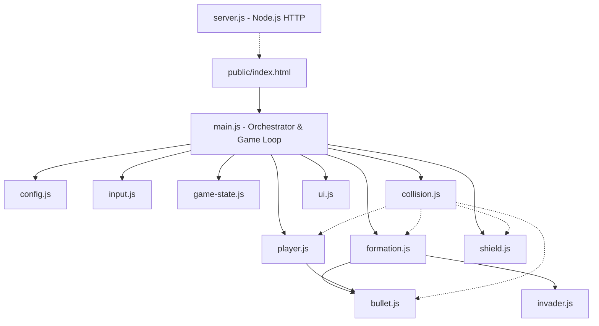

# Architektura Techniczna: Space Invaders

## 1. Przegląd Systemu i Stos Technologiczny

### 1.1. Model Architektoniczny
System został zaprojektowany w klasycznym modelu klient-serwer dla gier webowych z renderowaniem po stronie klienta (Client-Side Rendering):
- **Backend (Serwer Aplikacji):** Minimalistyczny serwer HTTP uruchamiany w środowisku Node.js z wykorzystaniem wyłącznie wbudowanych modułów standardowych (`http`, `fs`, `path`). Odpowiada za serwowanie plików statycznych klienta z katalogu `public/` z poprawnymi nagłówkami MIME oraz obsługą błędów 404. Całkowity brak zewnętrznych zależności npm (`zero dependencies`).
- **Frontend (Klient Gry):** Aplikacja oparta na natywnym HTML5 Canvas 2D API oraz modułowym Vanilla JavaScript (ES6 Modules). Całość logiki gry (fizyka, detekcja kolizji, sterowanie, maszyna stanów, pętla gry) wykonuje się w przeglądarce użytkownika.

### 1.2. Założenia Platformy
- **Środowisko backendowe:** Node.js LTS (>= v18), uruchamiane komendą `node server.js` lub `npm start`.
- **Środowisko frontendowe:** Nowoczesna przeglądarka internetowa z obsługą ES Modules i Canvas 2D.
- **Rozdzielczość planszy:** Stały obszar roboczy 800 × 600 px, wycentrowany w oknie przeglądarki.
- **Klatkaż:** Docelowe 60 FPS, pętla oparta o `requestAnimationFrame` z przekazywaniem czasu klatki (`deltaTime`).

---

## 2. Struktura Projektu (Drzewo Modułów)

```text
space_inv/
├── package.json              # Konfiguracja projektu i skrypt startowy ("start": "node server.js")
├── server.js                 # Serwer HTTP (Node.js built-in: http, fs, path)
├── requirements.md           # Wymagania projektowe (od Product Managera)
├── architecture.md           # Niniejszy dokument projektu technicznego
└── public/                   # Warstwa klienta serwowana przez serwer HTTP
    ├── index.html            # Struktura strony i kontener elementu <canvas>
    ├── css/
    │   └── style.css         # Stylizacja retro-arcade, wycentrowanie canvasa
    └── js/
        ├── config.js         # Centralny moduł konfiguracji i stałych gry
        ├── player.js         # Moduł statku gracza (pozycja, ruch, nietykalność)
        ├── bullet.js         # Moduł pocisków (zarówno gracza, jak i najeźdźców)
        ├── invader.js        # Moduł pojedynczej jednostki najeźdźcy
        ├── formation.js      # Moduł zarządzania całą siatką najeźdźców (5x11)
        ├── shield.js         # Moduł bunkrów obronnych i ich degradacji
        ├── collision.js      # Moduł matematyki i detekcji kolizji AABB
        ├── game-state.js     # Moduł zarządzania stanem, wynikiem i falami
        ├── input.js          # Moduł obsługi wejścia (klawiatura)
        ├── ui.js             # Moduł renderowania nakładek, HUD i ekranów gry
        └── main.js           # Główny punkt wejścia, pętla gry i orkiestracja
```

---

## 3. Zastosowanie Zasad DRY i SOLID

### 3.1. Zasada DRY (Don't Repeat Yourself)
- **Centralna Konfiguracja (`config.js`):** Wszelkie wartości liczbowe (wymiary planszy 800x600, prędkości obiektów, kolory, punkty za wroga, punkty życia, interwały czasowe) są zdefiniowane w jednym miejscu. Żaden moduł nie używa "magicznych liczb".
- **Uniwersalny Byt Pocisku (`bullet.js`):** Pociski gracza oraz pociski najeźdźców korzystają z tego samego modułu i kontraktu API, różniąc się jedynie parametrem kierunku/właściciela (`direction` / `owner`).
- **Wspólna Matematyka Kolizji (`collision.js`):** Funkcja testująca przecięcie prostokątów AABB jest zaimplementowana raz i używana przez wszystkie podsystemy gry.

### 3.2. Zasady SOLID
- **S – Single Responsibility Principle (Zasada Pojedynczej Odpowiedzialności):**
  - `player.js` odpowiada wyłącznie za stan i logikę gracza, nie renderuje HUD-u ani nie wykrywa kolizji.
  - `collision.js` zajmuje się wyłącznie czystą matematyką przecięć geometrycznych.
  - `ui.js` odpowiada tylko za rysowanie interfejsu (HUD, ekrany), nie modyfikuje stanu gry.
  - `server.js` serwuje wyłącznie pliki statyczne, nie zawiera logiki gry.
- **O – Open/Closed Principle (Zasada Otwarte/Zamknięte):**
  - Moduł `invader.js` i `formation.js` są otwarte na rozbudowę o nowe typy obcych (np. różne rzędy o odmiennych kształtach/animacjach) bez konieczności modyfikowania pętli głównej.
- **L – Liskov Substitution Principle (Zasada Podstawienia Liskov):**
  - Wszystkie renderowalne byty gry realizują spójny kontrakt cyklu życia: `update(dt)` oraz `render(ctx)`.
- **I – Interface Segregation Principle (Zasada Segregacji Interfejsów):**
  - Moduły udostępniają jedynie te metody, które są niezbędne dla orkiestratora. Np. `input.js` udostępnia proste zapytania o stan klawiszy (`isActionActive()`), ukrywając zdarzenia DOM.
- **D – Dependency Inversion Principle (Zasada Odwrócenia Zależności):**
  - `main.js` orkiestruje współpracę modułów w oparciu o ich publiczne abstrakcyjne interfejsy API, nie ingerując w ich wewnętrzne struktury danych.

---

## 4. Diagramy Architektoniczne

### 4.1. Diagram Zależności Modułów (Mermaid)



### 4.2. Diagram Pętli Gry (Game Loop Flow)

```text
[ requestAnimationFrame ]
          │
          ▼
   Oblicz deltaTime
          │
          ▼
   1. Pobierz Input (input.js)
          │
          ▼
   2. Aktualizuj Stan Gry (game-state.js, player.js, formation.js, bullets, shields)
          │
          ▼
   3. Przelicz Kolizje (collision.js)
      ├── Pociski Gracza vs Najeźdźcy
      ├── Pociski Gracza vs Osłony
      ├── Pociski Wrogów vs Osłony
      ├── Pociski Wrogów vs Gracz
      └── Najeźdźcy vs Linia Obrony Gracza
          │
          ▼
   4. Sprawdź Warunki Zmiany Stanu (Nowa Fala? Game Over?)
          │
          ▼
   5. Renderuj Klatkę (ctx.clearRect -> obiekty gry -> ui.js HUD/Overlays)
          │
          └─────────────────────────────► Następna klatka
```

### 4.3. Diagram Maszyny Stanów Gry (Finite State Machine)

```text
  ┌────────────────────────────────────────────────────────┐
  │                                                        │
  ▼                                                        │
[ START_SCREEN ] ──(Wciśnięcie Spacji / Start)──► [ PLAYING ]
                                                    │     ▲
           ┌────────────────────────────────────────┘     │
           │ (Wszystkich 55 obcych zniszczonych)          │
           ▼                                              │
    [ WAVE_CLEARED ] ──(Odczekanie interwału / Nowa fala)─┘
           │
           │ (Utrata 3 żyć LUB inwazja dotarła do gracza)
           ▼
     [ GAME_OVER ] ──(Wciśnięcie R / Restart)──► Reset do Fali 1
```

---

## 5. Specyfikacja Modułów i Kontrakty API

### 5.1. Moduł: `server.js`
- **Odpowiedzialność:** Serwowanie zasobów statycznych aplikacji webowej przez protokół HTTP.
- **Zależności:** Wbudowane moduły Node.js: `http`, `fs`, `path`.
- **Kontrakt:**
  - Port nasłuchiwania: konfigurowalny przez zmienną środowiskową `PORT` lub domyślnie `3000`.
  - Tabela mapowania rozszerzeń na MIME: `.html` -> `text/html`, `.css` -> `text/css`, `.js` -> `application/javascript`, `.json` -> `application/json`, `.png` -> `image/png`.
  - Obsługa ścieżek: automatyczne mapowanie ścieżki `/` na `/index.html`.
  - Obsługa błędów: zwracanie kodu 404 dla nieodnalezionych plików oraz 500 dla błędów odczytu.

---

### 5.2. Moduł: `config.js`
- **Odpowiedzialność:** Centralne repozytorium niemutowalnych stałych systemowych i parametrów balansu gry.
- **Zależności:** Brak.
- **Kontrakt API:** Eksport obiektu `CONFIG` zawierającego grupy parametrów:
  - `CANVAS`: `{ WIDTH: 800, HEIGHT: 600 }`
  - `PLAYER`: `{ WIDTH, HEIGHT, SPEED, LIVES, INVULNERABLE_TIME, MAX_BULLETS }`
  - `INVADERS`: `{ ROWS: 5, COLS: 11, WIDTH, HEIGHT, PADDING_X, PADDING_Y, BASE_SPEED_X, DROP_Y, SPEED_INCREASE_PER_WAVE, SHOOT_INTERVAL }`
  - `BULLET`: `{ WIDTH, HEIGHT, PLAYER_BULLET_SPEED, ENEMY_BULLET_SPEED }`
  - `SHIELD`: `{ COUNT: 4, MAX_HEALTH: 3, WIDTH, HEIGHT, Y_POS }`
  - `COLORS`: definicje kolorów retro (tło, gracz, najeźdźcy, pociski, osłony, HUD).

---

### 5.3. Moduł: `player.js`
- **Odpowiedzialność:** Zarządzanie stanem logicznym statku gracza, jego ruchem, nietykalnością i wystrzeliwaniem pocisków.
- **Zależności:** `config.js`, `bullet.js`.
- **Kontrakt API:**
  | Metoda / Właściwość | Parametry | Zwraca | Opis |
  | --- | --- | --- | --- |
  | `reset()` | brak | `void` | Przywraca pozycję początkową (środek) i usuwa stan nietykalności |
  | `moveLeft(dt)` | `number dt` | `void` | Przesuwa statek w lewo z uwzględnieniem lewej krawędzi |
  | `moveRight(dt)` | `number dt` | `void` | Przesuwa statek w prawo z uwzględnieniem prawej krawędzi |
  | `tryShoot(activeBullets)` | `Array<Bullet>` | `Bullet \| null` | Tworzy nowy pocisk gracza, jeśli nie przekroczono limitu 3 pocisków |
  | `hit()` | brak | `boolean` | Rejestruje trafienie gracza; jeśli nietykalny zwraca `false`, w przeciwnym razie aktywuje nietykalność i zwraca `true` |
  | `update(dt)` | `number dt` | `void` | Aktualizuje licznik czasu nietykalności |
  | `render(ctx)` | `CanvasRenderingContext2D` | `void` | Rysuje statek gracza (z efektem migotania, jeśli gracz jest nietykalny) |
  | `getBounds()` | brak | `{x, y, width, height}` | Zwraca prostokąt ograniczający AABB |

---

### 5.4. Moduł: `bullet.js`
- **Odpowiedzialność:** Uniwersalna reprezentacja pocisku poruszającego się pionowo.
- **Zależności:** `config.js`.
- **Kontrakt API:**
  | Metoda / Właściwość | Parametry | Zwraca | Opis |
  | --- | --- | --- | --- |
  | Konstruktor | `x, y, vy, isPlayerBullet` | `Bullet` | Inicjalizuje pocisk o danej pozycji, prędkości pionowej i typie |
  | `update(dt)` | `number dt` | `void` | Przesuwa pocisk w osi Y o wartość `vy * dt` |
  | `isOutOfBounds(canvasHeight)` | `number canvasHeight` | `boolean` | Zwraca `true`, gdy pocisk opuścił górną lub dolną krawędź ekranu |
  | `render(ctx)` | `CanvasRenderingContext2D` | `void` | Rysuje pocisk na planszy |
  | `getBounds()` | brak | `{x, y, width, height}` | Zwraca prostokąt ograniczający AABB |

---

### 5.5. Moduł: `invader.js`
- **Odpowiedzialność:** Pojedyncza jednostka najeźdźcy (pozycja, stan życia, rendering).
- **Zależności:** `config.js`.
- **Kontrakt API:**
  | Metoda / Właściwość | Parametry | Zwraca | Opis |
  | --- | --- | --- | --- |
  | Konstruktor | `gridRow, gridCol, x, y` | `Invader` | Tworzy najeźdźcę o zadanych współrzędnych siatki i pozycji |
  | `render(ctx)` | `CanvasRenderingContext2D` | `void` | Rysuje najeźdźcę na planszy |
  | `getBounds()` | brak | `{x, y, width, height}` | Zwraca prostokąt ograniczający AABB |

---

### 5.6. Moduł: `formation.js`
- **Odpowiedzialność:** Zarządzanie całą siatką 55 najeźdźców, ruchem grupowym, opadaniem, wykrywaniem krawędzi, przyspieszaniem i wyborem dolnych strzelców.
- **Zależności:** `config.js`, `invader.js`, `bullet.js`.
- **Kontrakt API:**
  | Metoda / Właściwość | Parametry | Zwraca | Opis |
  | --- | --- | --- | --- |
  | `init(wave)` | `number wave` | `void` | Generuje nową siatkę 5x11 obcych, skalując bazową prędkość o `(1 + 0.1 * (wave - 1))` |
  | `update(dt, canvasWidth)` | `number dt, number canvasWidth` | `void` | Przesuwa formację; w razie kontaktu z krawędzią opuszcza formację i zawraca |
  | `tryShoot(dt)` | `number dt` | `Bullet \| null` | Zwraca wrogi pocisk wystrzelony przez losowego najeźdźcę z dołu kolumny |
  | `removeInvader(invader)` | `Invader` | `void` | Usuwa zestrzelonego najeźdźcę z formacji i dynamicznie zwiększa tempo formacji |
  | `hasInvadersReachedY(targetY)` | `number targetY` | `boolean` | Zwraca `true`, jeśli którykolwiek żywy obcy dotarł do wysokości gracza |
  | `getAliveInvaders()` | brak | `Array<Invader>` | Zwraca tablicę wszystkich żywych najeźdźców |
  | `isEmpty()` | brak | `boolean` | Zwraca `true`, gdy zniszczono wszystkich 55 najeźdźców |
  | `render(ctx)` | `CanvasRenderingContext2D` | `void` | Wywołuje renderowanie dla każdego żywego najeźdźcy |

---

### 5.7. Moduł: `shield.js`
- **Odpowiedzialność:** Zarządzanie 4 osłonami obronnymi (bunkrami) i ich trzystopniową degradacją.
- **Zależności:** `config.js`.
- **Kontrakt API:**
  | Metoda / Właściwość | Parametry | Zwraca | Opis |
  | --- | --- | --- | --- |
  | `init()` | brak | `void` | Tworzy 4 symetrycznie rozstawione osłony, każda z `health = 3` |
  | `takeHit(shieldIndex)` | `number shieldIndex` | `boolean` | Zmniejsza wytrzymałość osłony o 1; gdy `health <= 0`, usuwa ją z gry |
  | `getShields()` | brak | `Array<ShieldObject>` | Zwraca listę aktywnych osłon wraz z ich pozycją i aktualnym HP |
  | `render(ctx)` | `CanvasRenderingContext2D` | `void` | Rysuje osłony z wizualną reprezentacją stopnia uszkodzenia |

---

### 5.8. Moduł: `collision.js`
- **Odpowiedzialność:** Czyste funkcje matematyczne testowania kolizji AABB.
- **Zależności:** Brak (moduł bezstanowy).
- **Kontrakt API:**
  | Funkcja | Parametry | Zwraca | Opis |
  | --- | --- | --- | --- |
  | `checkAABB(boxA, boxB)` | `{x, y, width, height}`, `{x, y, width, height}` | `boolean` | Zwraca `true`, gdy dwa prostokąty nachodzą na siebie |

---

### 5.9. Moduł: `game-state.js`
- **Odpowiedzialność:** Przechowywanie globalnego stanu rozgrywki: maszyna stanów, punkty, życia, numer fali.
- **Zależności:** `config.js`.
- **Kontrakt API:**
  | Metoda / Właściwość | Parametry | Zwraca | Opis |
  | --- | --- | --- | --- |
  | `getState()` | brak | `string` | Zwraca aktualny stan: `'START'`, `'PLAYING'`, `'GAME_OVER'` |
  | `setState(newState)` | `string newState` | `void` | Przełącza stan gry |
  | `addScore(points)` | `number points` | `number` | Dodaje punkty (np. +10 za obcego) i zwraca bieżący wynik |
  | `loseLife()` | brak | `number` | Odejmuje 1 życie i zwraca liczbę pozostałych istnień |
  | `nextWave()` | brak | `number` | Inkrementuje numer fali i zwraca nową wartość |
  | `reset()` | brak | `void` | Resetuje punkty do 0, życia do 3, falę do 1 i stan na `'START'` |
  | `getData()` | brak | `{score, lives, wave, state, reason}` | Zwraca niemutowalny obiekt stanu dla modułu UI |

---

### 5.10. Moduł: `input.js`
- **Odpowiedzialność:** Rejestrowanie i obsługa zdarzeń klawiatury (`keydown`, `keyup`), udostępnianie prostego API odpytywania o stan akcji.
- **Zależności:** Brak.
- **Kontrakt API:**
  | Metoda | Parametry | Zwraca | Opis |
  | --- | --- | --- | --- |
  | `init()` | brak | `void` | Rejestruje globalne listenery klawiatury w oknie przeglądarki |
  | `isLeftPressed()` | brak | `boolean` | Czy wciśnięty `ArrowLeft` lub klawisz `A` |
  | `isRightPressed()` | brak | `boolean` | Czy wciśnięty `ArrowRight` lub klawisz `D` |
  | `isShootPressed()` | brak | `boolean` | Czy wciśnięta `Spacja` (z flagą konsumpcji pojedynczego wciśnięcia) |
  | `isRestartPressed()` | brak | `boolean` | Czy wciśnięty klawisz `R` |

---

### 5.11. Moduł: `ui.js`
- **Odpowiedzialność:** Renderowanie elementów interfejsu użytkownika na kontekście Canvas (HUD, ekran powitalny, ekran końca gry).
- **Zależności:** `config.js`.
- **Kontrakt API:**
  | Metoda | Parametry | Zwraca | Opis |
  | --- | --- | --- | --- |
  | `renderHUD(ctx, stateData)` | `ctx, {score, lives, wave}` | `void` | Rysuje na górze planszy: wynik, życia oraz numer fali |
  | `renderStartScreen(ctx)` | `ctx` | `void` | Rysuje ekran tytułowy z instrukcją sterowania |
  | `renderGameOverScreen(ctx, stateData)` | `ctx, {score, wave, reason}` | `void` | Rysuje ekran końca gry z wynikiem i zachętą do restartu |

---

### 5.12. Moduł: `main.js`
- **Odpowiedzialność:** Główny orkiestrator. Inicjalizuje Canvas, tworzy instancje modułów, uruchamia pętlę gry `requestAnimationFrame`, synchronizuje fazy `update` i `render`.
- **Zależności:** Wszystkie moduły klienta (`config`, `input`, `gameState`, `player`, `formation`, `shield`, `collision`, `ui`).
- **Kontrakt:**
  - Inicjalizacja przy zdarzeniu `DOMContentLoaded`.
  - Pętla gry z pomiarem czasu `performance.now()` i obliczaniem `dt`.
  - Wywoływanie aktualizacji fizyki i kolizji tylko w stanie `'PLAYING'`.
  - Czyszczenie bufora i delegowanie renderowania w każdej klatce.

---

## 6. Wytyczne Wydajnościowe i Niefunkcjonalne

1. **Unikanie Alokacji Pamięci w Pętli Gry:**
   - Obiekty tablicowe pocisków i przeciwników powinny być modyfikowane na miejscu (filtrowanie/usuwanie in-place lub czyszczenie tablic) bez ciągłego tworzenia nowych instancji tam, gdzie nie jest to konieczne, aby wyeliminować zacięcia Garbage Collectora.
2. **Niezależność od Częstotliwości Odświeżania (`deltaTime`):**
   - Wszystkie przesunięcia w osi X i Y muszą być przemnażane przez czas klatki w sekundach: `pozycja += predkosc * dt`. Zapewnia to identyczną fizykę na monitorach 60Hz, 120Hz i 144Hz.
3. **Czystość Kodu dla Uczniów Technikum:**
   - Kod każdego modułu powinien być zorganizowany czytelnie, z polskimi komentarzami nagłówkowymi wyjaśniającymi cel modułu.
   - Brak skomplikowanych zależności — kod ma być łatwy do prześledzenia w celach edukacyjnych.
